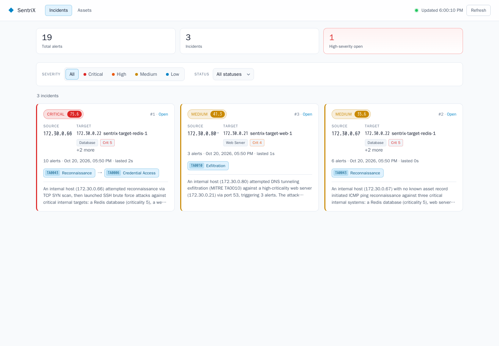
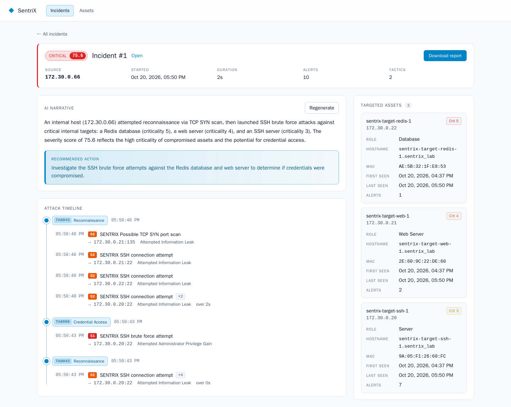

# SentriX

**AI-assisted network alert triage.** SentriX turns a flood of raw IDS alerts
into a short list of scored, narrated **incidents**. Suricata analyses network
captures, a correlation engine groups related alerts by source and maps them to
MITRE ATT&CK tactics, and a local or cloud LLM writes a plain-English narrative
and a recommended action for each incident. A React dashboard presents the
result, and every incident can be exported as a PDF report.

It ships with a self-contained lab — demo target hosts plus an opt-in attacker
container — so the full **attack → alert → incident → summary** loop can be run
end to end on one machine. In a sample run, **4,816 packets became 19 alerts and
3 incidents** (see [`evaluation.md`](evaluation.md)).

> **Scope.** SentriX is a learning/demo project. Its attack tooling is for the
> bundled, isolated lab network only. See [Security & scope](#security--scope).

---

## Architecture

```
                         ┌──────────────────────── sentrix_lab (172.30.0.0/24) ────────────────────────┐
                         │                                                                              │
  pcaps/*.pcap           │   ┌────────────┐   ┌────────────┐   ┌──────────────┐   ┌──────────────┐      │
  (captured traffic) ───────▶│  Suricata  │   │ target-ssh │   │  target-web  │   │ target-redis │      │
                         │   │  (IDS,     │   │   (.20)    │   │    (.21)     │   │    (.22)     │      │
                         │   │  offline)  │   └────────────┘   └──────────────┘   └──────────────┘      │
                         │   └─────┬──────┘          ▲                                                   │
                         │         │ eve.json        │ nmap / hydra / scapy                              │
                         │         ▼                 │                                                   │
                         │   ┌───────────────────────┴───────────┐        ┌───────────┐                 │
                         │   │            backend (FastAPI)       │        │  attacker │ (opt-in)        │
                         │   │                                    │        │  (.66)    │                 │
                         │   │  watcher → /alerts → raw_alerts    │        └───────────┘                 │
                         │   │  correlation job → incidents       │                                      │
                         │   │    · group by src · MITRE tactics  │        ┌───────────┐                 │
                         │   │    · severity (× asset criticality)│───────▶│ PostgreSQL│                 │
                         │   │  LLM summarizer → narrative/action │        │   (db)    │                 │
                         │   │  asset scanner (nmap) → assets     │        └───────────┘                 │
                         │   └─────────────────┬──────────────────┘                                      │
                         │                     │ REST (:8000)                                            │
                         └─────────────────────┼───────────────────────────────────────────────────────┘
                                               ▼
                                       ┌────────────────┐        ┌──────────────┐
                                       │  frontend      │        │  Ollama (local)  or             │
                                       │  React (:5173) │        │  cloud LLM API   (LLM_BACKEND)  │
                                       └────────────────┘        └──────────────┘
```

**Pipeline, step by step:**

1. Suricata reads packet captures from `pcaps/` and writes `alert` events to
   `logs/eve.json` (offline mode — it reprocesses on `restart`).
2. The backend **watcher** tails `eve.json` and POSTs each alert to `/alerts`,
   storing it in `raw_alerts` (deduplicated by a stable fingerprint).
3. The **correlation job** runs on an interval: it groups un-correlated alerts
   by source IP into incidents, scores each one (severity × targeted-asset
   criticality), and tags the MITRE ATT&CK tactics in the order they occurred.
4. Incidents at or above a severity threshold are **summarized by the LLM**
   (local Ollama or a cloud API); a template fallback is stored if the LLM is
   down.
5. The **dashboard** lists incidents by severity; a detail page shows the
   narrative, recommended action, attack timeline and targeted assets, plus a
   **PDF export**.

---

## Features

- **Suricata IDS integration** — offline pcap analysis with custom rules
  (`suricata/rules/local.rules`): port scans, SSH brute force, DNS tunneling,
  stealth scans, ICMP.
- **Alert ingestion** — a tailing watcher forwards `eve.json` alerts to the API,
  idempotent across re-runs.
- **Correlation engine** — sliding-window grouping by source into incidents;
  pure-stdlib and unit-testable.
- **Severity scoring** — combines alert severity, volume and signature diversity,
  multiplied by the criticality of the targeted asset (an attack on a
  criticality-5 database scores far higher than the same attack on a workstation).
- **MITRE ATT&CK tagging** — maps signatures/categories to tactics so the
  timeline reads as an attack story (Reconnaissance → Credential Access → …).
- **AI narratives** — per-incident summary and one-line recommended action from
  a pluggable LLM backend; runs automatically for high-severity incidents.
- **Asset inventory** — nmap-based scanner infers host roles (web server, DB,
  workstation…) and criticality, and upserts into an `assets` table.
- **React dashboard** — incident cards sorted by severity, severity/status
  filters, overview counts, an assets table with an in-browser scan trigger, and
  a per-incident detail page.
- **PDF reports** — download any incident as a formatted report.
- **Self-contained attack lab** — demo targets and an opt-in attacker container
  to drive the whole pipeline (see [Running the attack lab](#running-the-attack-lab)).

---

## Tech stack

| Layer | Technology |
|-------|-----------|
| IDS | Suricata 7 (`jasonish/suricata`) |
| Backend | Python 3.12, FastAPI, SQLAlchemy 2, httpx |
| Database | PostgreSQL 16 |
| LLM | Ollama (local, default) or Anthropic Messages API (cloud) |
| Frontend | React 18, Vite 5 (plain CSS, no UI framework) |
| Reports | ReportLab |
| Asset scan | nmap |
| Lab tooling | nmap, hydra, scapy, tcpdump (attacker container) |
| Orchestration | Docker Compose |

---

## Prerequisites

- **Docker** and **Docker Compose v2** (`docker compose …`).
- Roughly 4 GB free RAM and a few GB of disk for images.
- **For local LLM summaries:** [Ollama](https://ollama.com) running on the host
  with a model pulled, e.g. `ollama pull qwen3:8b`. The backend reaches it at
  `http://host.docker.internal:11434`. (You can skip this and use the cloud
  backend, or just generate summaries on demand later — see
  [Switching the LLM backend](#switching-the-llm-backend).)

No Python, Node or Suricata install is needed on the host — everything runs in
containers.

---

## One-command setup

```sh
cp .env.example .env          # set POSTGRES_PASSWORD; keep DATABASE_URL in sync
docker compose up --build
```

Then open:

- **Dashboard** — http://localhost:5173
- **API docs** — http://localhost:8000/docs

To see data immediately, download a sample capture and (re)run Suricata:

```sh
./scripts/get_sample_pcap.sh          # fetches a public Nmap scan capture
docker compose restart suricata       # processes everything in pcaps/
```

Incidents appear on the dashboard within ~30s (the correlation interval). To
populate the asset inventory, open the **Assets** tab and click **Run asset
scan**, or:

```sh
curl -X POST localhost:8000/assets/scan      # scans SCAN_SUBNET (lab by default)
```

> **Note on `.env`:** Postgres reads `POSTGRES_PASSWORD` only when it first
> creates its data volume. If you change it later, update `DATABASE_URL` to match
> and run `docker compose down -v` (this wipes the database).

### Services

| Service | Purpose | Port |
|---------|---------|------|
| `db` | PostgreSQL 16 | — |
| `backend` | FastAPI: ingestion, correlation, LLM, scanner, reports | 8000 |
| `frontend` | React + Vite dashboard | 5173 |
| `suricata` | Processes `pcaps/` into `logs/eve.json`, then exits | — |
| `target-ssh` / `target-web` / `target-redis` | Lab targets (.20 / .21 / .22) | — |
| `attacker` | Opt-in attack toolbox (profile `attack`) | — |

All services share the `sentrix_lab` network (`172.30.0.0/24`). The targets and
attacker have fixed IPs and publish no ports to the host.

---

## Running the attack lab

> **Lab use only.** The attacker container and scripts are hardcoded to the lab
> target IPs (172.30.0.20–22) and refuse anything outside `172.30.0.0/24`.
> Nothing is installed on your host. Do not point them at any other network.

The `attacker` container (nmap, hydra, scapy, tcpdump) is **not** started by
`docker compose up` — it sits behind the `attack` compose profile. Build it once,
then run the four scenarios:

```sh
docker compose --profile attack build attacker
docker compose --profile attack run --rm attacker /scripts/run_attacks.sh all
docker compose restart suricata        # process the captured pcaps
```

`scripts/run_attacks.sh` runs four labeled scenarios, each captured to its own
pcap:

1. **Reconnaissance** — `nmap -sS` SYN scan of the targets
2. **Credential access** — `hydra` SSH brute force against `target-ssh`
3. **ARP cache poisoning** — a scapy MITM setup against `target-web`
4. **Exfiltration** — a scapy DNS-tunneling traffic simulation

Run a single scenario with its number, e.g. `… /scripts/run_attacks.sh 2`.

Within ~30s the dashboard shows the resulting incidents, scored and tagged with
MITRE tactics. The scenarios 1 + 2 share a source IP and **correctly correlate
into one multi-stage incident** (Reconnaissance → Credential Access). The full
walk-through and noise-reduction measurements are in
[`evaluation.md`](evaluation.md).

---

## Switching the LLM backend

The summarizer is pluggable via the `LLM_BACKEND` environment variable.

### Local (default) — Ollama

```ini
LLM_BACKEND=ollama
OLLAMA_URL=http://host.docker.internal:11434
OLLAMA_MODEL=qwen3:8b
```

Runs entirely on your machine. Pull the model first (`ollama pull qwen3:8b`).
Summaries take tens of seconds on a local model.

### Cloud — Anthropic Messages API

```ini
LLM_BACKEND=cloud
ANTHROPIC_API_KEY=sk-ant-...
CLOUD_MODEL=claude-sonnet-5-5
```

Set these in `.env` and restart the backend (`docker compose up -d backend`).

If the configured backend is unavailable, incidents still get a **template
fallback summary** and are retried automatically. You can also (re)generate any
summary on demand from the incident detail page (**Regenerate**) or via
`POST /incidents/{id}/summarize`.

Both backends share `LLM_TIMEOUT` (seconds). Auto-summarization is tuned with
`SUMMARIZE_THRESHOLD`, `SUMMARIZE_BATCH` and `SUMMARIZE_RETRY_SECONDS` (see
`.env.example`).

---

## Screenshots

**Dashboard** — incidents sorted by severity with overview counts:



**Incident detail** — AI narrative, recommended action, MITRE attack timeline and
targeted assets (recon escalating to credential access):



More per-scenario screenshots (ARP MITM, DNS tunneling) are in
[`evaluation.md`](evaluation.md) and [`docs/img/`](docs/img/).

---

## Project layout

```
backend/app/
  main.py                FastAPI app, startup tasks
  db.py  models.py       SQLAlchemy engine + tables
  ingest/watcher.py      tails eve.json → /alerts
  routes/                alerts, assets, incidents (+ PDF) endpoints
  correlation/
    engine.py            group_alerts, score_incident, tag_mitre (pure stdlib)
    job.py               background correlation + auto-summarization loop
  assets/scanner.py      nmap asset discovery
  llm/                   base, ollama_backend, cloud_backend, factory, summarizer
  reports/pdf.py         incident → PDF
frontend/src/            React dashboard (pages, components, api)
suricata/                suricata.yaml, rules/local.rules, run.sh
scripts/                 get_sample_pcap.sh, run_attacks.sh
attacker/                attacker container image + scapy scripts
docs/img/                screenshots
evaluation.md            full attack-to-insight evaluation
```

---

## Configuration reference

All settings live in `.env` (copy from `.env.example`). Highlights:

| Variable | Default | Purpose |
|----------|---------|---------|
| `POSTGRES_*`, `DATABASE_URL` | — | Database credentials (keep them in sync) |
| `LLM_BACKEND` | `ollama` | `ollama` (local) or `cloud` |
| `OLLAMA_URL`, `OLLAMA_MODEL` | `…11434`, `qwen3:8b` | Local LLM |
| `ANTHROPIC_API_KEY`, `CLOUD_MODEL` | — | Cloud LLM |
| `SCAN_SUBNET` | `172.30.0.0/24` | Default subnet for asset scans |
| `CORRELATION_WINDOW_MINUTES` | `10` | Max gap between alerts of one incident |
| `CORRELATION_INTERVAL_SECONDS` | `30` | How often correlation runs |
| `SUMMARIZE_THRESHOLD` | `50` | Auto-summarize incidents scoring ≥ this |
| `TARGET_SSH_USER` / `TARGET_SSH_PASSWORD` | `labuser` / `labpass` | Lab SSH target login |

---

## Security & scope

- SentriX is a **demo/learning project**, not a production SIEM.
- The attacker container and `run_attacks.sh` are **for the bundled, isolated lab
  network only**, and are hardcoded to the lab target IPs. Only ever run offensive
  tooling against systems you own or are explicitly authorized to test.
- The lab SSH target ships **deliberately weak credentials** and the targets
  publish no ports to the host — keep it that way.
- ARP cache poisoning is layer 2 and largely invisible to signature IDS; SentriX
  surfaces it only via the attacker's layer-3 traffic. This is documented as an
  honest detection gap in [`evaluation.md`](evaluation.md).

---

## Future work

- **Live capture** — run Suricata on a live interface (AF_PACKET) instead of
  offline pcap replay, for real-time detection.
- **Incident lifecycle** — analyst actions (acknowledge, assign, resolve/close)
  and so closed incidents stop absorbing new alerts.
- **Richer correlation** — correlate across source IPs (campaigns), destination
  and asset, not just by source; tunable rules per environment.
- **Store open ports & services** on assets (currently shown only from the last
  scan) and track asset history.
- **Suricata rule metadata** — use each rule's own MITRE mapping where present
  instead of keyword heuristics.
- **Alerting & integrations** — push high-severity incidents to Slack/email;
  export to a real SIEM or SOAR.
- **AuthN/AuthZ** — the API and dashboard are currently unauthenticated.
- **Tests & CI** — unit tests for the correlation engine and scorer, plus an
  end-to-end pipeline test in CI.
- **Scheduled scanning** — periodic asset scans and drift detection.

---

## License

Provided as-is for educational and demonstration purposes.
