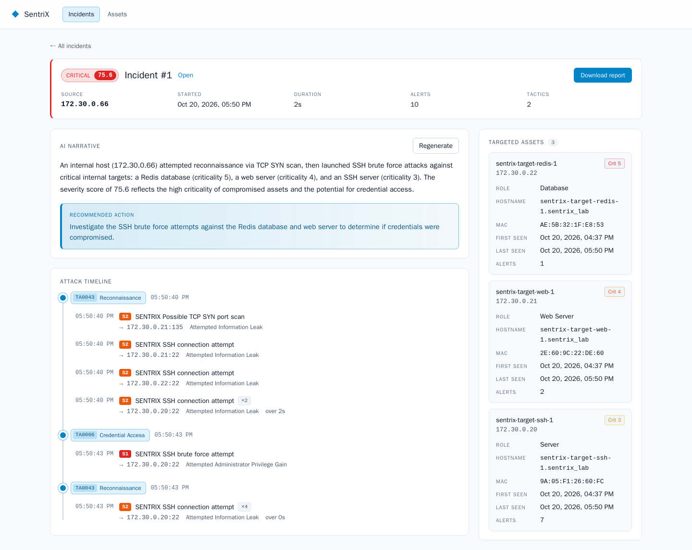
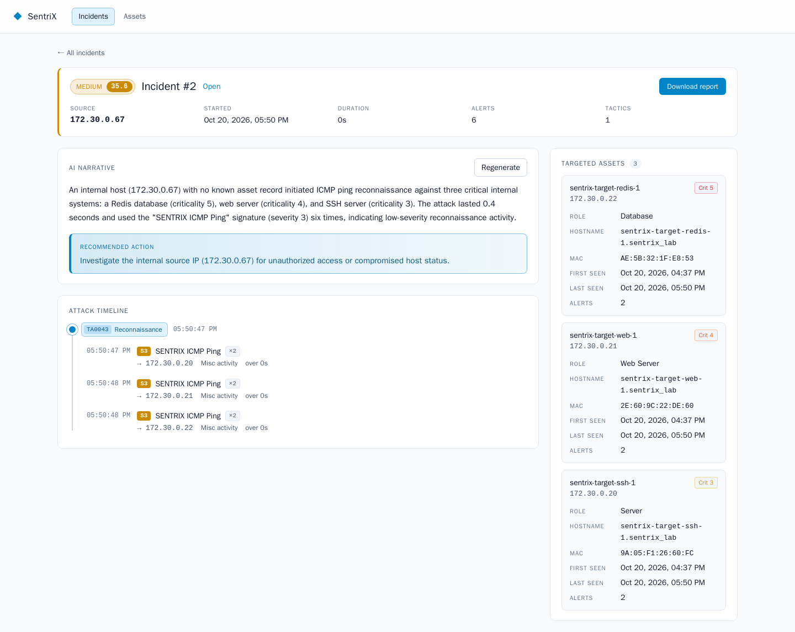
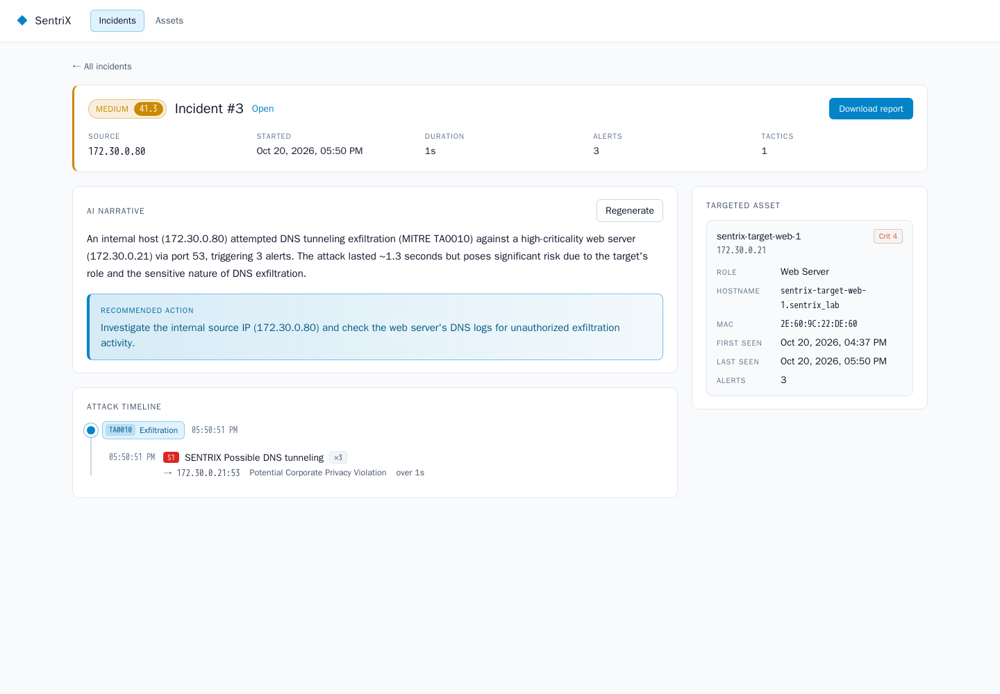
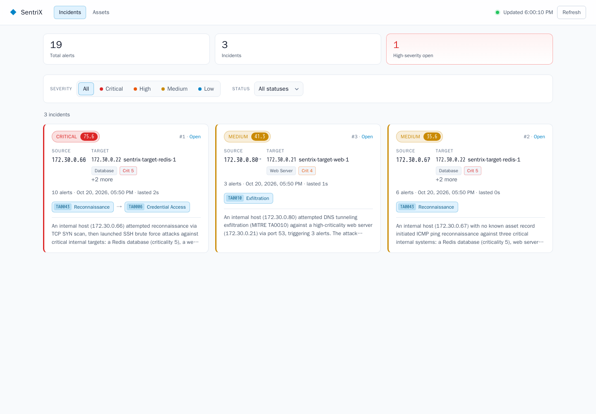

# SentriX — Attack-to-Insight Evaluation

This document records a full run of the four lab attack scenarios through the
SentriX pipeline and the noise-reduction it achieves. Everything below was
produced on the isolated `sentrix_lab` Docker network (172.30.0.0/24) against
the demo target containers — never a real network.

## The loop under test

For every scenario the same path is exercised:

```
attacker container        Suricata            backend                         UI
──────────────────  →  ───────────────  →  ──────────────────────────  →  ──────────
run_attacks.sh         eve.json alerts     POST /alerts  (raw_alerts)       dashboard
(nmap/hydra/scapy)     (offline pcap)      correlation job → incidents      incident
                                           LLM summarizer → narrative        detail + PDF
```

1. `scripts/run_attacks.sh` runs an attack from the `attacker` container and
   captures its traffic to `pcaps/attack_<n>.pcap`.
2. `docker compose restart suricata` processes the pcaps; matched rules
   (`suricata/rules/local.rules`) become `alert` events in `logs/eve.json`.
3. The eve.json watcher POSTs each alert to `/alerts` (deduplicated).
4. The correlation job groups alerts by source into incidents, scores them by
   target criticality, and tags MITRE ATT&CK tactics.
5. Incidents at or above the severity threshold are summarized by the LLM
   (others on demand via the **Regenerate** button / `POST /…/summarize`).
6. The dashboard lists incidents by severity; the detail page shows the
   narrative, recommended action, timeline and targeted assets; a PDF report is
   downloadable.

## How to reproduce

```sh
docker compose up -d                         # stack + lab targets
docker compose --profile attack build attacker
docker compose --profile attack run --rm attacker /scripts/run_attacks.sh all
docker compose restart suricata              # process the captured pcaps
# watch http://localhost:5173 — incidents appear within ~30s (correlation interval)
```

## Scenarios

| # | Scenario | Tool | Source | Target(s) | Suricata rule → MITRE tactic |
|---|----------|------|--------|-----------|------------------------------|
| 1 | Reconnaissance (SYN scan) | `nmap -sS` | 172.30.0.66 | .20/.21/.22 | TCP SYN port scan, SSH connection attempt → **Reconnaissance (TA0043)** |
| 2 | Credential access (SSH brute force) | `hydra` | 172.30.0.66 | target-ssh (.20) | SSH brute force attempt → **Credential Access (TA0006)** |
| 3 | ARP cache poisoning (MITM) | scapy | 172.30.0.67* | target-web (.21) | ICMP ping from MITM position → **Reconnaissance (TA0043)** |
| 4 | Exfiltration (DNS tunneling) | scapy | 172.30.0.80 | target-web (.21) | Long-label DNS query → **Exfiltration (TA0010)** |

\* Scenarios 1 and 2 share source 172.30.0.66, so correlation **intentionally
merges them into one multi-stage incident** (recon escalating to credential
access) — which is the core value of the tool. Scenario 3's ARP poisoning is
layer 2 (see the detection-gap note below); the incident is raised from the
layer-3 ICMP the man-in-the-middle emits, under source .67.

## Results — noise reduction

Captured on 2026-10-20.

| Scenario | Packets captured | Suricata alerts | Incident |
|----------|-----------------:|----------------:|----------|
| 1 — recon (nmap) | 623 | 2 (scan + SSH attempts, see note) | **#1** |
| 2 — brute force (hydra) | 124 | 8 (SSH attempts) + 1 (brute) | **#1** |
| 3 — ARP / MITM ICMP | 99 | 6 (ICMP) | **#2** |
| 4 — DNS tunneling | 3,970 | 3 (DNS tunnel) | **#3** |
| **Total** | **4,816** | **19** | **3 incidents** |

Note: scenarios 1 and 2 both come from 172.30.0.66, so their 10 alerts form a
single incident (#1). The per-row counts above sum to the 19 total alerts.

**Noise-reduction ratios**

| Stage | From | To | Ratio |
|-------|-----:|---:|------:|
| Packets → alerts (Suricata) | 4,816 | 19 | **253 : 1** |
| Alerts → incidents (correlation) | 19 | 3 | **6.3 : 1** |
| Packets → incidents (analyst-facing) | 4,816 | 3 | **1,605 : 1** |

An analyst reviews **3 scored, narrated incidents** instead of 4,816 packets or
19 raw alerts. Each incident arrives with a severity (weighted by target
criticality), an ordered MITRE ATT&CK story, a plain-English summary, a
recommended action, and a downloadable PDF.

## Per-scenario verification

### Scenarios 1 + 2 — Reconnaissance → Credential Access (Incident #1)

`nmap` SYN scan followed by `hydra` SSH brute force from 172.30.0.66. Correlation
merged the 10 alerts into one **Critical (75.6)** incident spanning two tactics.
The timeline shows the SYN scan and SSH probes (Reconnaissance) escalating to the
brute-force attempt (Credential Access). Severity is high because the targets
include the criticality-5 Redis database and criticality-4 web server.



### Scenario 3 — ARP poisoning / MITM (Incident #2)

scapy poisons target-web's ARP cache to impersonate the gateway, then emits an
ICMP sweep from the man-in-the-middle position (172.30.0.67). SentriX raises a
**Medium (35.6)** Reconnaissance incident from that ICMP activity.



> **Detection-gap note.** ARP cache poisoning is a layer-2 technique: the
> spoofed ARP replies are not IP traffic and are not matched by Suricata
> signature rules. SentriX therefore cannot see the poisoning itself — only the
> anomalous layer-3 traffic the attacker generates once in position. Detecting
> the ARP spoofing directly would require a dedicated L2 monitor (e.g.
> `arpwatch`) or Suricata's ARP decoder events, which are out of scope here.
> This is a genuine, honest limitation of a signature-IDS-driven pipeline.

### Scenario 4 — DNS tunneling / Exfiltration (Incident #3)

scapy sends a burst of DNS queries whose labels are long base32-encoded chunks
(spoofed source 172.30.0.80). The long-label rule fires, producing a **Medium
(41.3)** Exfiltration incident against the web server.



### Dashboard overview

All three incidents, sorted by severity, with the overview counts
(19 alerts · 3 incidents · 1 high-severity open). The dashboard uses a light
theme (white surfaces, sky-blue `#0284c7` accent, slate text) with severity
color-coding (red / orange / amber / blue).



## Caveats

- **Simulated, not real.** The DNS-tunneling script generates the traffic
  *pattern* only; it moves no real data and contacts no real resolver. The ARP
  script restores the real mapping after a few rounds.
- **Offline Suricata.** Suricata reads captured pcaps, not a live tap, so alerts
  appear only after `docker compose restart suricata`.
- **Local LLM variance.** Summaries come from the configured model (`qwen3:8b`
  by default) and occasionally mislabel details — e.g. it calls the lab's
  private source addresses "internal", which is technically correct for RFC 1918
  space but would read oddly for a public attacker. Treat narratives as
  analyst aids, not ground truth.
- **Severity scores** depend on the asset inventory; run an asset scan first so
  targets resolve to roles and criticalities.
